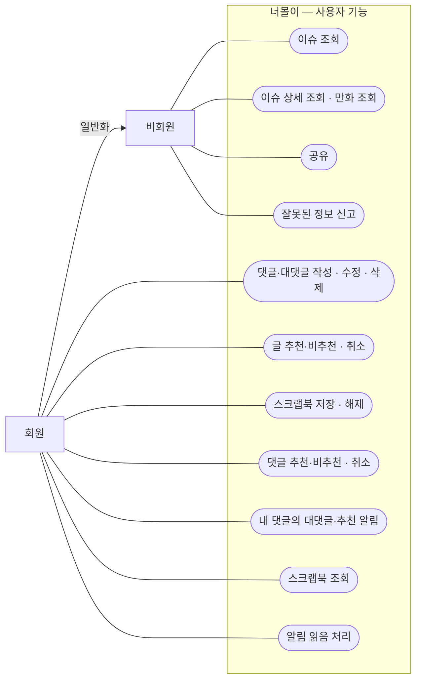
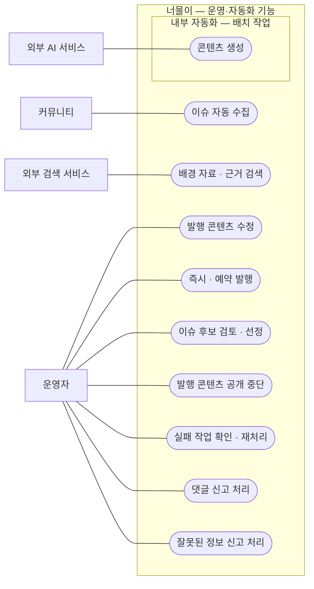

# 너몰이 유스케이스

> 작성일: 2026-10-28 · 버전: 0.1  
> 사용자가 작성한 유스케이스 다이어그램을 기준으로 사용자 기능과 운영·자동화 기능을 정리한 문서입니다.

## 1. 참여자와 범위

| 참여자 | 역할 |
| --- | --- |
| 비회원 | 이슈 조회, 만화 조회, 공유, 잘못된 정보 신고 |
| 회원 | 비회원의 모든 기능과 댓글, 추천·비추천, 스크랩북, 알림 이용 |
| 운영자 | 이슈 후보 선정, 발행 관리, 신고 처리, 실패 작업 재처리 |
| 커뮤니티 | 자동 수집할 이슈 원문 제공 |
| 외부 검색 서비스 | 배경 자료와 근거 검색 지원 |
| 외부 AI 서비스 | 배치 작업에서 요청하는 콘텐츠 생성 지원 |

원본의 ‘배치 작업’은 외부 사용자 액터가 아닌 내부 자동화 처리로 구분합니다. 이슈 수집은 Spring Batch로 구현하며, 콘텐츠 생성 배치의 구체적인 구현 방식은 별도로 설계합니다.

## 2. 사용자 기능

### 2.1 유스케이스 다이어그램

Mermaid flowchart로 유스케이스를 표현합니다. 회원에서 비회원으로 향하는 화살표는 비회원 기능을 모두 이용할 수 있다는 일반화 관계를 뜻합니다.

### 2.2 기능 목록

| ID | 유스케이스 | 이용자 | 내용 |
| --- | --- | --- | --- |
| U-01 | 이슈 조회 | 비회원·회원 | 이슈 목록을 조회한다. |
| U-02 | 이슈 상세 조회·만화 조회 | 비회원·회원 | 선택한 이슈의 상세 내용과 만화를 확인한다. |
| U-03 | 공유 | 비회원·회원 | 이슈 링크를 공유한다. |
| U-04 | 잘못된 정보 신고 | 비회원·회원 | 이슈의 잘못된 정보를 신고한다. |
| U-05 | 댓글·대댓글 작성·수정·삭제 | 회원 | 댓글과 대댓글을 작성하고 본인 댓글을 수정·삭제한다. |
| U-06 | 글 추천·비추천·취소 | 회원 | 이슈에 추천 또는 비추천하고 반응을 취소한다. |
| U-07 | 스크랩북 저장·해제 | 회원 | 이슈를 스크랩북에 저장하거나 저장을 해제한다. |
| U-08 | 댓글 추천·비추천·취소 | 회원 | 댓글에 추천 또는 비추천하고 반응을 취소한다. |
| U-09 | 내 댓글의 대댓글·추천 알림 | 회원 | 본인 댓글에 달린 대댓글과 추천에 대한 알림을 받는다. |
| U-10 | 스크랩북 조회 | 회원 | 저장한 이슈 목록을 조회한다. |
| U-11 | 알림 읽음 처리 | 회원 | 확인한 알림을 읽음 상태로 변경한다. |

비추천 알림은 제공 범위에 포함하지 않습니다. 원본 다이어그램에 따라 잘못된 정보 신고는 비회원에게도 허용합니다.

## 3. 운영·자동화 기능

### 3.1 유스케이스 다이어그램

내부 자동화는 별도 영역에 표시합니다. 연결선은 참여 관계를 나타내며 실행 순서를 나타내지는 않습니다.

### 3.2 기능 목록

| ID | 유스케이스 | 주체·연계 대상 | 내용 |
| --- | --- | --- | --- |
| O-01 | 이슈 자동 수집 | 내부 자동화·커뮤니티 | Spring Batch로 커뮤니티의 이슈 원문을 주기적으로 수집한다. |
| O-02 | 배경 자료·근거 검색 | 외부 검색 서비스 | 이슈를 설명할 배경 자료와 근거를 검색한다. |
| O-03 | 발행 콘텐츠 수정 | 운영자 | 발행된 콘텐츠를 수정한다. |
| O-04 | 즉시·예약 발행 | 운영자 | 콘텐츠를 즉시 공개하거나 공개 시각을 예약한다. |
| O-05 | 이슈 후보 검토·선정 | 운영자 | 수집된 이슈 후보를 검토하고 제작 대상을 선정한다. |
| O-06 | 발행 콘텐츠 공개 중단 | 운영자 | 발행된 콘텐츠의 공개를 중단한다. |
| O-07 | 실패 작업 확인·재처리 | 운영자 | 실패한 작업과 오류를 확인하고 재처리한다. |
| O-08 | 댓글 신고 처리 | 운영자 | 접수된 댓글 신고를 확인하고 처리한다. |
| O-09 | 잘못된 정보 신고 처리 | 운영자 | 접수된 정보 오류 신고를 확인하고 필요한 수정을 진행한다. |
| O-10 | 콘텐츠 생성 | 내부 배치 작업·외부 AI | 선정한 이슈를 바탕으로 요약·대본·만화 콘텐츠를 생성한다. |

## 4. 후속 상세 설계 항목

원본에 없는 기능을 확정 범위로 추가하지 않고, 다음 항목은 후속 설계에서 구체화합니다.

- 회원·운영자의 로그인 및 권한 정책
- 댓글 신고 접수 화면과 처리 결과 안내
- 추천·비추천의 중복 방지와 반응 변경 정책
- 콘텐츠 검수·승인 절차와 예약 발행 조건
- 알림 전달 방식과 설정 기능
- 자동 수집의 실행 주기, 대상 커뮤니티, 실패·재시작 정책
